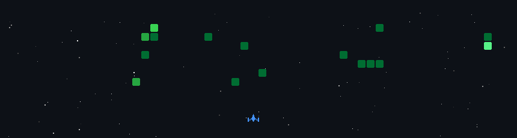

<!-- Header Animasi -->

 

<!-- Github Contributions Shooter -->
<h3 align="center">My Contribution Space Shooter</h3>

  

<!-- GLASSMORPHISM CARD (Tentang Saya & Tech Stack) -->

<table border="0" cellpadding="20" cellspacing="0" style="border-radius: 20px; border: 1px solid rgba(255, 255, 255, 0.15); background: rgba(255, 255, 255, 0.03); box-shadow: 0 8px 32px 0 rgba(0, 0, 0, 0.4);">
<tr>
<td width="65%" valign="top" style="border-right: 1px solid rgba(255, 255, 255, 0.05);">
<h2 style="margin-top: 0; color: #3B82F6;">Tentang Saya</h2>

- Lulusan S1 <b>Teknik Informatika</b> (2026). 
- Berfokus pada <b>Web & Mobile App</b> serta integrasi <b>Artificial Intelligence.</b> 
- Memiliki keahlian praktis dalam <i>troubleshooting</i> software, hardware, dan konfigurasi jaringan. 
- Tertarik dengan otomatisasi alur kerja digital (FFmpeg & AI). 
- Hubungi saya: <strong><a href="mailto:apongaf21@gmail.com" style="color: #00FF99;">apongaf21@gmail.com</a></strong>

 
<h3 style="margin-top: 0;">Tech Stack & Tools</h3>

<b>Software Development & AI:</b> 

<b>IT Support & Infrastructure:</b> 

</td>
<td width="35%" align="center" valign="middle">

</td>
</tr>
</table>

  

### Statistik GitHub

